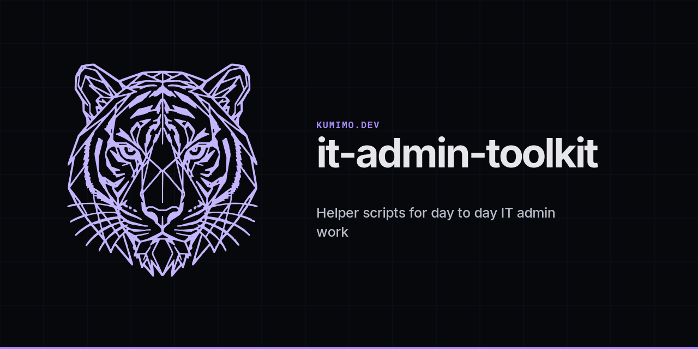

# it-admin-toolkit

Small Windows, network and Acronis Cyber Protect Cloud helpers for a personal IT admin lab. Use these beside the companion `intune-home-lab` repository when you want everyday tools that are not tied to Autopilot or Intune packaging.

## What is in the folders

1. `windows/` inventory, Defender checks, BitLocker status, winget, local lab user, scan share, OS update and ISO upgrade helpers.
2. `network/` DNS flush, Winsock reset and quick connectivity checks.
3. `acronis/` API token and agent list samples plus sanitised policy JSON shapes.
4. `office/` light Adobe Reader and Microsoft 365 Apps inventory notes.
5. `docs/` documentation habits and a tiny Edge allow list sample with public Microsoft hosts only.

## Safety

1. Never commit passwords, API client secrets, tenant UUIDs or real data centre account URLs.
2. Set `ACRONIS_DATA_CENTER`, `ACRONIS_CLIENT_ID` and `ACRONIS_CLIENT_SECRET` in the environment when you try the Acronis samples.
3. Replace every placeholder such as `lab.example.com`, `10.0.0.x` and zeroed GUIDs.
4. Keep MFA backup codes, mailbox migration reports and cloud service account keys out of any public repo and out of shared Drive folders.

## Quick start

1. Clone this repo to a lab PC.
2. Run `windows/Test-DefenderRealtime.ps1` or `windows/Export-InstalledApps.ps1` to confirm PowerShell execution policy allows local scripts.
3. For Acronis, create a least privilege API client in your lab tenant, export the values to environment variables, then run `acronis/Get-AcronisApiToken.ps1`.

## Related repo

Intune Autopilot, remediations and Win32 packaging samples live in `intune-home-lab`.

## Author

Weng Hong CHOO (`kumimodev` on GitHub)

## Licence

MIT. See `LICENSE`.
